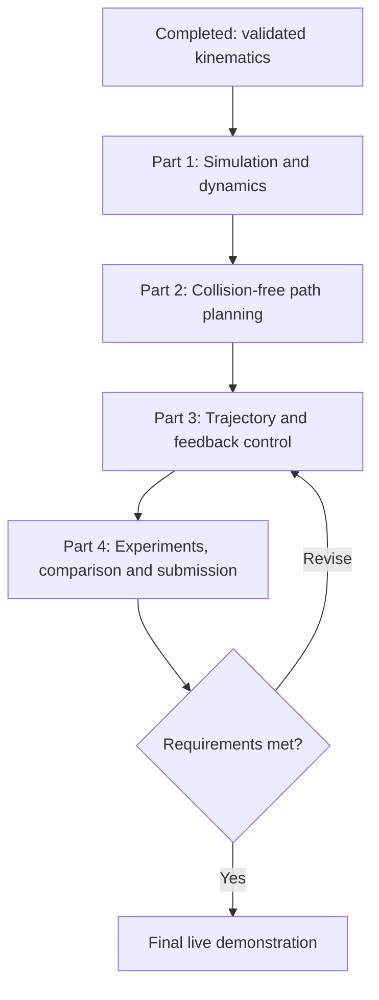

# PUMA 560 Project: Four-Part Work Distribution

## Starting point and project goal

Forward kinematics, inverse kinematics, velocity kinematics, and their validation are **already complete**. Reuse these modules; validation is not assigned as new work below.

**Goal:** Execute collision-free PUMA 560 motions in MuJoCo using student-written planning, trajectory generation, and feedback control, then evaluate performance through experiments and a quantitative comparison.

The four parts can be assigned to four members. Each owner implements and documents their part, but every member must understand the complete pipeline and be able to modify it during evaluation.

## Work allocation at a glance

| Part | Main responsibility | Main output |
| --- | --- | --- |
| 1 | Simulation, dynamics, and collision interface | Torque-driven MuJoCo environment |
| 2 | Task definition and collision-aware path planning | Feasible goal and collision-free joint path |
| 3 | Trajectory generation and feedback control | Robot tracking a timed motion |
| 4 | Experiments, quantitative comparison, and integration | Reproducible results, report, and demo |

## Simple flowchart

The diagram shows the final data flow. Development should overlap: Part 3 can begin with a direct obstacle-free path while Part 2 develops the planner; Part 4 can build logging and metrics immediately.

## Part 1 — MuJoCo simulation, dynamics, and collision interface

**Purpose:** Provide the physical environment used by all other parts.

### Tasks

1. Freeze the shared robot conventions: six-joint order, radians, SI units, end-effector frame, joint limits, and actuator mapping. Reuse the validated model.
2. Check the dynamic model: link masses, centres of mass, inertia tensors, gravity, damping, and collision geometry. Document any assumed parameters rather than presenting them as original PUMA specifications.
3. Configure torque actuation, actuator limits, and the simulation timestep. Ensure the mapping from control input to joint torque is explicit; actuator gear ratios affect this mapping.
4. Create a nominal scene and an obstacle scene. Support an optional rigid payload attached to the end effector.
5. Provide functions to reset the robot, read joint positions and velocities, apply torque, advance physics, and read the end-effector pose.
6. Provide configuration and edge collision checks using MuJoCo. Include self-collision and robot–environment collision, while excluding intended adjacent-link contacts as appropriate.
7. Keep planning collision queries separate from the live simulation state, for example using a separate simulation-data instance. A planner query must not accidentally move or reset the executing robot.
8. Derive and implement gravity compensation from link masses and centre-of-mass Jacobians, coordinating its sign convention with Part 3. Verify it against simulator quantities.

### Mathematics to explain

The dynamic model is

\[
M(q)\ddot q+C(q,\dot q)\dot q+g(q)=\tau,
\]

with additional friction/contact terms where applicable. MuJoCo may perform physics integration; the team must explain the model and assumptions. A complete student implementation of inverse dynamics is an optional extension, not necessary for the proposed PD-based scope.

For world gravitational acceleration \(g_w\), calculate the compensating gravity torque as

\[
\hat g(q)=-\sum_\ell J_{v,c_\ell}(q)^T m_\ell g_w.
\]

### Suggested outputs

- `simulation.py`: state, torque, reset, and stepping interface.
- `collision.py`: configuration and edge validity checks.
- `gravity.py`: student-written gravity compensation.
- Robot/scene XML files and documented model parameters.

### Completion criteria

- Applied torques produce dynamic motion without manually overwriting joint positions during execution.
- Collision queries distinguish valid and blocked configurations.
- Payload and obstacle settings can be changed through configuration.
- The rest of the team can use the environment through a documented interface.

## Part 2 — Task definition and collision-aware path planning

**Purpose:** Determine a safe geometric route from the initial configuration to a desired end-effector pose.

### Tasks

1. Define the task using an initial joint configuration and a reachable target pose. Only require orientation if the existing IK supports it.
2. Reuse IK to generate candidate goal configurations. Reject candidates violating joint limits or collision constraints; choose a feasible candidate, considering distance from the start.
3. Implement a direct joint-space connection as the baseline:

   \[
   q(s)=q_{start}+s(q_{goal}-q_{start}),\quad s\in[0,1].
   \]

4. Implement RRT in six-dimensional joint space using NumPy: random sampling, nearest-node search, steering, edge checking, goal connection, and backtracking.
5. Check intermediate configurations along every edge, not just its endpoints. Document the sampling resolution and its limitations.
6. Implement collision-checked shortcut smoothing to reduce unnecessary detours.
7. Handle unreachable goals, invalid starts, and planning timeouts with explicit failure results.
8. Return the path as a NumPy array of shape `(K, 6)`, together with planning time, random seed, success status, and joint-space path length.

### Suggested outputs

- `planning.py`: direct connection, RRT, and shortcut smoothing.
- Task configurations containing start, target pose, and planner settings.
- A visualization of the robot route around an obstacle.

### Completion criteria

- The nominal direct path succeeds in free space.
- A chosen obstacle blocks the direct connection, while RRT finds a valid alternative.
- The returned path respects joint limits and passes the collision checker.
- Planner behavior is reproducible from recorded settings and seeds.

**Boundary:** A path specifies where to move. Part 3 determines when to visit its configurations.

## Part 3 — Trajectory generation and feedback control

**Purpose:** Turn the planned route into smooth timed references and execute them using student-written feedback control.

### Tasks

1. Begin with a direct two-configuration path in free space so controller development does not wait for RRT.
2. Implement quintic time scaling. For a segment of duration \(T\), with \(u=t/T\):

   \[
   s(u)=10u^3-15u^4+6u^5,\qquad q_d=q_a+(q_b-q_a)s(u).
   \]

3. Derive and implement analytic desired velocity and acceleration. The trajectory evaluator must return `q_des`, `qd_des`, and `qdd_des`, each of shape `(6,)`.
4. Assign segment durations to satisfy selected joint velocity and acceleration limits. For a first implementation, stop at each waypoint; acknowledge the extra execution time.
5. Recheck the generated trajectory for collisions. If later interpolation changes the geometric path, it needs fresh collision checking.
6. Implement joint-space PD control:

   \[
   e=q_d-q,\quad \dot e=\dot q_d-\dot q,\quad
   \tau=K_p e+K_d\dot e.
   \]

7. Implement the comparison controller, PD with gravity compensation:

   \[
   \tau=K_p e+K_d\dot e+\hat g(q).
   \]

8. Apply torque saturation and record both requested and applied torques.
9. Tune per-joint gains on a slow nominal trajectory. Increase proportional gains for accuracy and derivative gains for damping; monitor oscillation, tracking error, and saturation.
10. Document final gains, tuning trials, controller period, and trajectory durations. Use simulator state feedback directly; sensor noise is optional.

### Suggested outputs

- `trajectory.py`: timed joint references.
- `control.py`: PD and PD plus gravity compensation.
- Controller configuration with gains and torque limits.
- Initial tracking plots from the nominal task.

### Completion criteria

- The control loop reads actual state and computes torques at every control update.
- The robot tracks a motion dynamically and holds the final target within a declared tolerance.
- References satisfy the selected velocity and acceleration limits.
- Both controllers use the same interface and can be selected by configuration.

## Part 4 — Experiments, comparison, integration, and final submission

**Purpose:** Demonstrate that the complete system works and support conclusions with quantitative evidence.

This owner builds the experiment runner, logging, and analysis early. Each other owner contributes their methodology, figures, and interpretation to the final report.

### Required experiment set

| Experiment | Conditions | Main question |
| --- | --- | --- |
| 1. Nominal motion | No obstacle, nominal model, moderate trajectory speed | Does the integrated system track and reach the target? |
| 2. Obstacle avoidance | Obstacle blocks the direct connection | Can the planner produce a route that the controller executes without collision? |
| 3. Payload robustness | Added end-effector payload; retain nominal gains and nominal gravity model | How does model mismatch affect tracking and torque demand? |

Specify the payload mass, location, and inertia. Experiment 3 deliberately leaves the controller model unchanged to test robustness. An updated payload-aware gravity model can be an additional case, clearly labelled.

### Mandatory comparative study

Compare **PD versus PD with gravity compensation** on the same nominal trajectory, and preferably repeat under the payload condition.

- Keep start state, reference trajectory, simulation settings, torque limits, and gains identical to isolate gravity compensation.
- Report the model used by the compensation term.
- Give both controllers sufficient time to settle and use the same measurement interval.
- Do not claim one controller is universally superior from a single task.

### Logging and metrics

Log time, actual and desired joint states, end-effector pose, requested/applied torques, collision events, and experiment settings.

| Metric | Interpretation |
| --- | --- |
| Per-joint tracking RMSE | Average tracking accuracy, in radians |
| Maximum joint error | Worst tracking deviation |
| Final end-effector position error | Target accuracy, in metres |
| Final orientation error, if orientation is controlled | Rotation accuracy, in radians |
| Per-joint peak and RMS applied torque | Actuator demand and torque effort |
| Torque saturation duration | Time spent at actuator limits |
| Collision count or collision-free success | Validity of executed motion |
| Planning time and path length | Planner behavior |

For joint \(i\),

\[
\mathrm{RMSE}_i=\sqrt{\frac{1}{N}\sum_{k=1}^{N}(q_{d,i}[k]-q_i[k])^2}.
\]

Use multiple recorded seeds for randomized planning and report success counts and planning-time variation. Identical deterministic controller runs do not need artificial repetition. RMS torque is effort, not energy consumption.

### Final outputs

- `run_experiments.py` and `analyse_results.py`.
- Saved configurations and raw numerical logs.
- Joint tracking, tracking-error, torque, and end-effector-path plots.
- Quantitative controller comparison table.
- Concise report covering formulation, assumptions, methodology, results, limitations, conclusions, and individual contributions.
- Complete source code and execution instructions.
- Live demo with selectable nominal, obstacle, and payload cases.

### Completion criteria

- At least three meaningful experiments are reproducible.
- The comparison uses quantitative metrics and controlled conditions.
- Executed obstacle motions are checked for contact, not only planned paths.
- Another member can reproduce the figures and demo from the instructions.

## Shared interfaces and integration order

Agree on these contracts before implementation. Names are suggestions, not existing project files.

| Interface | Contract |
| --- | --- |
| State | Joint position and velocity arrays, each `(6,)`, in fixed joint order |
| Planning output | Waypoints `(K, 6)`, plus status and planning metadata |
| Trajectory evaluation | Desired position, velocity, and acceleration at time `t` |
| Controller output | Six joint torques in N m, before actuator mapping |
| Collision check | Configuration/edge validity with documented contact exclusions |
| Logs | Same timestamps, units, joint order, and experiment identifier across modules |

1. **First integration:** Part 1 environment + Part 3 direct quintic motion + PD controller. Part 4 records baseline logs.
2. **Second integration:** Add gravity compensation and tune the controllers.
3. **Third integration:** Connect Part 2 RRT output to the trajectory generator; run the obstacle task.
4. **Final integration:** Freeze settings, run all experiments, generate comparison plots, and rehearse the demonstration.

## Final group checklist

- [x] FK, IK, velocity kinematics, and kinematic validation completed.
- [ ] Dynamic simulation uses explicit, documented model parameters.
- [ ] Core planning, trajectory, and feedback algorithms are implemented by the team using basic Python/NumPy.
- [ ] MuJoCo is used for permitted physics, visualization, collision checking, and verification.
- [ ] Controller gains and tuning are justified.
- [ ] At least three experiments, including a challenging condition, are complete.
- [ ] At least one quantitative comparative study is complete.
- [ ] Report, source, instructions, plots, numerical results, and live demo are ready.
- [ ] Every member can explain and modify the complete implementation.
